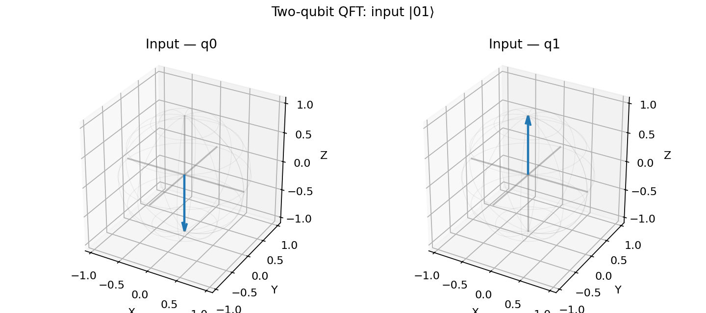
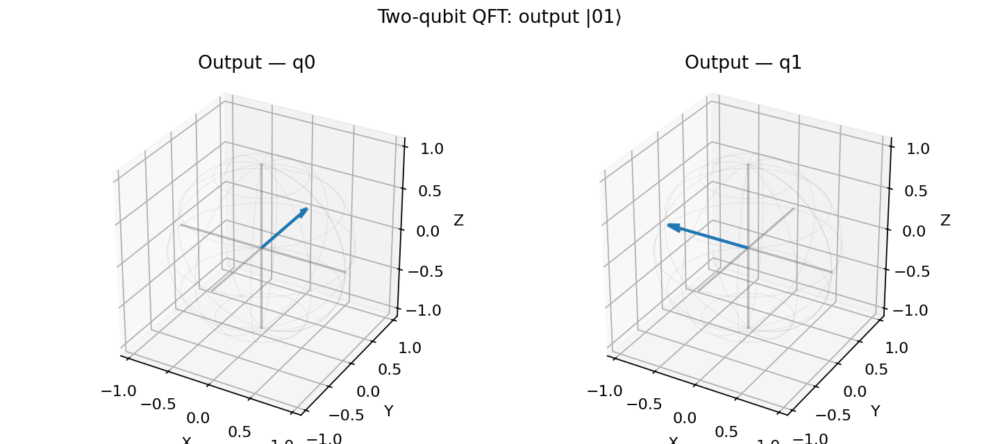
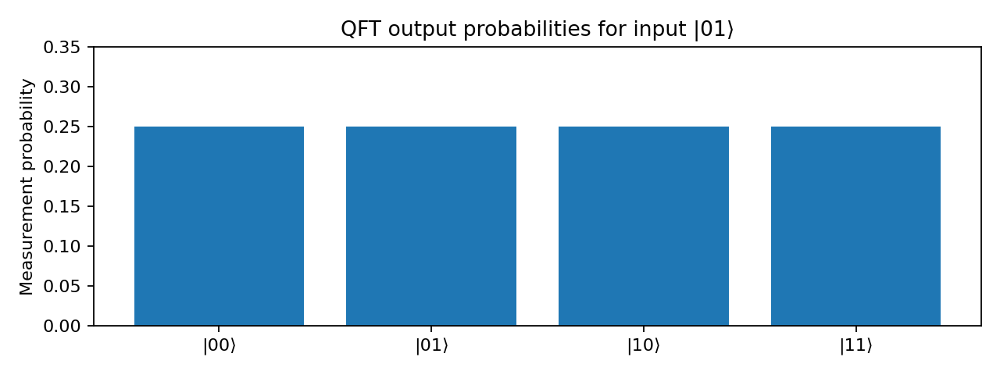

# Two-Qubit Quantum Fourier Transform (QFT) and Bloch Sphere Visualization
<!--
**Level:** Undergraduate  
**Platform:** Google Colab or Jupyter Notebook  
**Estimated time:** 60–90 minutes
--->
## Learning objectives

Students will construct a two-qubit QFT circuit, verify its unitary matrix, visualize input and output qubit states on Bloch spheres, and interpret the difference between measurement probabilities and quantum phases.

## 1. Theory

The quantum Fourier transform on an \(n\)-qubit register with \(N=2^n\) is

\[
\operatorname{QFT}|x\rangle=\frac{1}{\sqrt N}\sum_{k=0}^{N-1}e^{2\pi i xk/N}|k\rangle.
\]

The Fourier matrix uses the **positive exponent** convention. This differs from the common classical forward DFT convention, which uses a negative exponent.

For \(N=4\):

\[
F_4=\frac12\begin{bmatrix}1&1&1&1\\1&i&-1&-i\\1&-1&1&-1\\1&-i&-1&i\end{bmatrix}.
\]

## 2. Install packages

In a Google Colab cell, run:

```python
%pip install -q qiskit qiskit-aer matplotlib pylatexenc
```

## 3. Complete executable Qiskit code

```python
import numpy as np
from qiskit import QuantumCircuit
from qiskit.quantum_info import Operator, Statevector
from qiskit.visualization import plot_bloch_multivector, plot_histogram
from qiskit_aer import AerSimulator
from IPython.display import display

# Positive-exponent QFT, compatible with Qiskit's little-endian convention
def qft(n):
    qc = QuantumCircuit(n)
    for j in reversed(range(n)):
        qc.h(j)
        for k in reversed(range(j)):
            qc.cp(np.pi / 2**(j-k), k, j)
    for j in range(n // 2):
        qc.swap(j, n - 1 - j)
    return qc

n = 2
N = 2**n
indices = np.arange(N)
F = np.exp(2j * np.pi * np.outer(indices, indices) / N) / np.sqrt(N)
U = Operator(qft(n)).data

print('QFT equals Fourier matrix:', np.allclose(U, F))
print('QFT unitary check:', np.allclose(U.conj().T @ U, np.eye(N)))

# Prepare |01>: q0=1, q1=0
input_qc = QuantumCircuit(n)
input_qc.x(0)
input_state = Statevector.from_instruction(input_qc)

print('Input state:', input_state.data)
display(plot_bloch_multivector(input_state))

# Apply QFT and inspect the output
qc = input_qc.compose(qft(n))
output_state = Statevector.from_instruction(qc)
print('Output state:', np.round(output_state.data, 4))
display(plot_bloch_multivector(output_state))
display(qc.draw('mpl'))

# Measure output probabilities
measured = qc.copy()
measured.measure_all()
counts = AerSimulator().run(measured, shots=1024).result().get_counts()
print('Measurement counts:', counts)
display(plot_histogram(counts))

# Visualize all computational-basis inputs
for x in range(N):
    state = Statevector.from_int(x, N).evolve(qft(n))
    print(f'QFT |{x:0{n}b}> =', np.round(state.data, 3))
    display(plot_bloch_multivector(state))
```

## 4. Expected results

The matrix comparisons should both return `True`. For input \(|01\rangle\), the QFT output is

\[
\operatorname{QFT}|01\rangle=\frac12\left(|00\rangle+i|01\rangle-|10\rangle-i|11\rangle\right).
\]

Each computational-basis measurement outcome has probability \(1/4\). However, the four amplitudes have **different phases**.

### Figure 1 — Input Bloch spheres



The input \(|01\rangle\) has qubit 0 pointing along \(-Z\) and qubit 1 along \(+Z\).

### Figure 2 — Output Bloch spheres



After QFT, qubit 0 points along \(+Y\) and qubit 1 along \(-X\). The output for this particular basis input is separable, so each Bloch vector lies on the sphere surface.

### Figure 3 — Measurement probabilities



All four outcomes are equally likely. The histogram alone cannot reveal the relative phases; Bloch-sphere plots help expose them for these separable states.

## 5. Student exercises

1. Change the prepared input to \(|00\rangle\), \(|10\rangle\), and \(|11\rangle\). Compare the Bloch spheres.
2. Verify numerically that \(\operatorname{QFT}^{\dagger}\operatorname{QFT}=I\).
3. Apply `qft(n).inverse()` after `qft(n)` and check that the original state is recovered.
4. Explain why equal measurement probabilities do not imply equal quantum states.
5. Prepare an entangled input and inspect the reduced single-qubit Bloch vectors. Explain why they may lie inside the Bloch sphere.

## 6. Important notes

- Qiskit uses **little-endian** qubit indexing: `q0` is the least significant bit in the computational-basis index.
- `plot_bloch_multivector` shows **one reduced Bloch vector per qubit**, not a single sphere representing the entire multi-qubit state.
- The QFT is a unitary transform of **quantum amplitudes**, not a routine for reading out a complete classical Fourier spectrum in one measurement.
- The supplied PNG figures are illustrative outputs computed directly from the ideal QFT matrix; running the Qiskit code generates its own corresponding plots.
